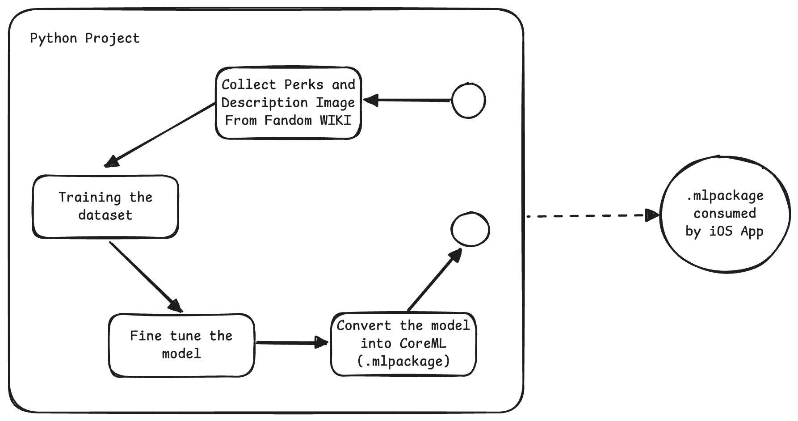

# DBD Perks Dataset & Classifier  
*A machine‑learning pipeline for classifying perks in Dead by Daylight*

This repository contains a full workflow to:

- scrape perk icons & descriptions  
- build a dataset (raw + augmented images)  
- train a CNN classifier  
- convert the model to CoreML for iOS/macOS use  
- run quick tests for inference  

> **Note:** This project is for educational purposes only.

---

## 📁 Repository Structure

```
dbd_perks_dataset/
│
├── raw/ ← Original perk icon images (1 sample per perk)
│ ├── File:IconPerks_aceInTheHole.png
│ ├── File:IconPerks_barbecueAndChilli.png
│ └── …
│
├── augmented/ ← Augmented image folders for each perk
│ ├── File:IconPerks_aceInTheHole/
│ │ ├── File:IconPerks_aceInTheHole_0.png
│ │ └── …
│ ├── File:IconPerks_barbecueAndChilli/
│ │ ├── File:IconPerks_barbecueAndChilli_0.png
│ │ └── …
│
├── metadata.json ← JSON mapping perk keys → name, description, page URL
├── dbd_perk_labels.json ← JSON mapping classifier labels → display name + description
│
├── train_dbd_perks_model.py ← Script to train the Keras model
├── convert_to_core_ml_model.py ← Script to convert trained model to CoreML
├── quick_test_model.py ← Script to quickly test inference on a single image
│
└── build_dbd_perk_dataset.py ← Web‑scraper to build dataset from the wiki
```

### Roadmap
The model consumed by this [iOS Project](https://github.com/alifu/DBD-Perks)



---

## 🕷️ Crawler v2 (`crawler/`)

Builds one clean, versioned `data/perks.json` (name, role, owner, description, flavor, icon) straight from the
Fandom *Perks* page tables — icon and name come from the same row, so nothing is guessed from file names.

```bash
pip install -r requirements-dev.txt
python3 -m crawler                  # fetch, validate, write data/perks.json, download data/icons/<id>.png
python3 -m crawler --offline        # reuse cache/Perks.json
python3 -m crawler.validate data/perks.json
python3 -m crawler.legacy_labels    # map the v1 model labels to the new ids
python3 -m pytest --cov=crawler
```

- Polite: identifiable User-Agent, `maxlag`, ≥ 1 s between API calls, retries with backoff, unchanged wiki revisions are skipped.
- Safe: JSON-schema validation, duplicate-id check, and a guard that aborts if the perk count drops more than 5 %.
- Descriptions with a "based on Patch X" banner keep the text and record the patch in `descriptionPatch`.
- `owner` is empty for generic (teachable) perks.

---

## 🎮 Game data tools (`tools/`)

The wiki lags behind the game, so these scripts use the community datamine API
([dbd.tricky.lol](https://dbd.tricky.lol/api), extracted from the game files, updated each patch).
Python standard library only, so they run the same on Windows, macOS and Linux.

### 1. Crawl the game data — `tools/crawl_dbd_api.py`

```bash
python tools/crawl_dbd_api.py                    # perks, characters, items, addons, offerings, maps, dlc -> data/game/
python tools/crawl_dbd_api.py perks addons       # only these endpoints
python tools/crawl_dbd_api.py --all              # also gamemodes, journals, customizations, archives, rift
python tools/crawl_dbd_api.py --force            # download even if the version is unchanged
python tools/crawl_dbd_api.py --compare "<app>/DBD Perks/Resources/perks.json"   # list perks the app lacks
```

- Each endpoint is saved as `data/game/<endpoint>.json`, exactly as served (a dict keyed by game id).
- An endpoint is skipped when its version in `/api/versions` is unchanged since the last run.
- Polite: identifiable User-Agent, 1 s between requests. No Cloudflare bypass: if the API answers 403/429 the script stops.
- macOS with a python.org Python: if you get `CERTIFICATE_VERIFY_FAILED`, run its "Install Certificates.command" once.
- Icons are **not** downloaded (the API only gives in-game paths such as `/Game/UI/UMGAssets/Icons/Perks/Quiche/T_UI_iconsPerks_FiveMovesAhead`).
  Export those textures from your own game install (e.g. with FModel); `iconFile` in the converted JSON holds the matching file name.
  Do not scrape icons from sites that forbid it (nightlight.gg disallows AI training and blocks scripts).

### 2. Convert to the app's `perks.json` — `tools/convert_game_data.py`

```bash
python tools/convert_game_data.py \
    --existing "<app>/DBD Perks/Resources/perks.json" \
    --out perks.new.json
```

- Descriptions come from the game data: HTML becomes plain text with `•` bullets, `{Tunable.X.Y}` becomes the per-tier values (`50/75/100`), `{Keyword.X}` becomes the keyword.
- Perks already in `--existing` keep their **id** (the model's labels are these ids), flavor text and wiki icon; name, owner, role and description are refreshed.
- New perks get a new id, no `iconUrl`, and an `iconFile` with the game texture name.
- Perks only in `--existing` are kept and listed, never deleted. If the game data lacks a number for a description, the existing text is kept.
- Matching an existing perk: exact name, then icon texture name, then a close name (accents ignored, similarity ≥ 0.9).
- The printed report lists loose matches, added perks, kept perks and unresolved placeholders. Check it, then copy `perks.new.json` over the app's `Resources/perks.json`.
- New perks are unknown to the classifier until it is retrained with their icons.

### 3. Find look-alike mistakes — `tools/confusion_report.py`

The iOS debug build logs scans to `Documents/ScanLog` and files crops you mark "Wrong?" under the correct perk.

```bash
xcrun devicectl device copy from --device <udid> --domain-type appDataContainer \
    --domain-identifier AppWork.DBD-Perks --source Documents/ScanLog --destination ./ScanLog
python tools/confusion_report.py ./ScanLog --top 20
```

Prints the most confused perk pairs (the set to oversample when retraining) and the most often misread perks.

### 4. Import icons and retrain — `tools/import_game_icons.py`

Export the perk textures from your own game install with FModel (`.../UI/UMGAssets/Icons/Perks`, "Save Folder's Packages Textures (.png)") into `data/game/Perks/`, then:

```bash
cp <app>/Resources/perks.json data/perks.json           # the converted perks
python tools/import_game_icons.py                       # copies icons of perks that have none into data/icons/<id>.png
python train_perks_v2.py && python export_coreml_v2.py  # then copy models/v2/DBDPerkClassifierV2.mlpackage into the app
```

`data/game/` and `data/icons/` are git-ignored on purpose: the icons are the game's copyrighted assets, so **never commit images** (perks, add-ons, items, ...). Only `perks.json`, `labels.json` and `metrics.json` are committed.

---

## 🚀 Model v2 (PyTorch, trains on the Apple GPU)

v2 replaces the Keras pipeline. Instead of a folder of pre-augmented images it **generates training images on the fly**:
the transparent wiki icon is placed on a random rarity-coloured background, then degraded like a phone photo of a screen
(perspective, low resolution, blur, colour/white-balance shifts, glare, moiré, noise, JPEG). Labels are the perk ids from `data/perks.json`.

```bash
pip install -r requirements-train.txt
export SSL_CERT_FILE=$(python3 -c "import certifi;print(certifi.where())")   # python.org builds lack root certs
python3 train_perks_v2.py             # ~7 min on an M-series Mac (MPS); --smoke for a 30 s check
python3 export_coreml_v2.py           # models/v2/DBDPerkClassifierV2.mlpackage + Core ML vs PyTorch parity check
python3 -m pytest --cov=crawler --cov=synth
```

- MobileNetV2 (ImageNet weights), 128×128 RGB input, normalization inside the model, so Core ML only needs `scale=1/255`.
- Same Core ML interface as v1: input `input_1`, outputs `classLabel` and `classLabel_probs`.
- Perks that share one icon file (the wiki's `Unknown_QuestionMark` placeholder) are excluded: they cannot be told apart.
- Reported accuracy (`models/v2/metrics.json`) comes from **synthetic** images of the same icons, so it is optimistic.
  The real test is photos of a screen: put crops in `real_photos/<perk_id>/*.jpg` and run `python3 evaluate_real.py`.

---

## 🛠 Workflow

### 1. Build the dataset  
Use the scraper script (e.g. `build_dbd_perk_dataset.py`) to download perk icon images and descriptions from the Dead by Daylight Fandom wiki, then run the augmentation script to generate additional training images (~50 per perk).

### 2. Train the model  
Use `train_dbd_perks_model.py`. This script:
- loads the augmented images  
- splits into training / validation sets  
- uses a pre‑trained model (e.g. MobileNetV2) for transfer‑learning  
- fine‑tunes the model  
- saves the model (e.g. `dbd_perks_model.keras`)  
- produces a label‑map JSON (`dbd_perk_labels.json`)

### 3. Convert to CoreML  
Use `convert_to_core_ml_model.py`. This script:
- loads the saved Keras model  
- optionally patches compatibility issues  
- converts to a CoreML format (`.mlpackage` for newer iOS/macOS or `.mlmodel` for older)  
- embeds metadata (labels + descriptions)  
- saves the output (e.g. `DBDPerkClassifier.mlpackage`)

### 4. Quick test / Inference  
Use `quick_test_model.py` to run inference on a sample perk icon from `raw/`.  
It loads the model, finds a sample image, preprocesses it (resize + normalize), runs prediction, and prints the top result with confidence + optional description.

---

## ⚠️ Compatibility & Notes

- *TensorFlow / Keras versions:*  
  Due to compatibility issues, it’s recommended to use TensorFlow **2.12.0** with its bundled Keras.  
  Newer TensorFlow versions (2.15+) may require manual patches for CoreML conversion.  
- *CoreML format:*  
  - For iOS 15 / macOS 12 and newer: use `.mlpackage` (ML Program format)  
  - For older systems: specify `convert_to="neuralnetwork"` and save as `.mlmodel`.  
- *Dataset details:*  
  - One raw icon image per perk  
  - ~50 augmented images per perk folder  
  - Metadata includes perk name, image file reference, description, and wiki page URL  
- This project is **for learning purposes only**. Please respect the rights and usage policies of the original game and wiki content.

---

## 📋 Example Usage (Terminal)

```bash
# 1) Scrap the dataset from Fandom WIKI
python3 build_dbd_perk_dataset.py

# 2) Train the model
python3 train_dbd_perks_model.py

# 3) Convert the model to CoreML
python3 convert_to_core_ml_model.py

# 3.1) Run a quick test
python3 quick_test_model.py
```

---

## 🧠 Model Conversion & Visualization

This section explains how to convert your fine-tuned Dead by Daylight perk classifier to CoreML for iOS apps, and how to visualize Grad-CAM heatmaps to understand the model’s predictions.

### 🍏 Convert to CoreML (`convert_tuned_to_coreml.py`)

After you have fine-tuned your model (tuned_dbd_perks_model.keras), you can convert it into a CoreML .mlpackage model for integration into your iOS app.

Usage
```bash
python3 convert_tuned_to_coreml.py
```

Script Overview

- Loads your fine-tuned .keras model.
- Converts it to a .mlpackage (the modern CoreML format).
- Embeds metadata such as author, license, and JSON label mapping.
- Saves the result as DBDPerkClassifier_Tuned.mlpackage.

Output
```bash
✅ CoreML model saved as DBDPerkClassifier_Tuned.mlpackage
```


You can now import this file into Xcode and use it via VNCoreMLModel or Swift’s CoreML framework for on-device inference.

## 🔥 Grad-CAM Visualization (visualize_gradcam.py)

Grad-CAM helps you see which regions of a perk image the model focuses on during classification — perfect for debugging or improving dataset accuracy.

Usage
```bash
python3 visualize_gradcam.py path/to/perk_image.png
```

Example
```bash
python3 visualize_gradcam.py samples/a_nurse_calling.png
```

What it does
- Loads your trained model (dbd_perks_model.keras or fine-tuned one).
- Preprocesses the input image and predicts its class.
- Displays the top 5 most likely perks with confidence percentages.
- Generates a Grad-CAM overlay to highlight image regions influencing the decision.

Output Example
```bash
🎯 Top 5 Predictions:
 1. A Nurse's Calling             92.34%
 2. Dark Theory                   4.28%
 3. Kindred                       1.65%
 4. Empathy                       0.87%
 5. Bond                           0.42%

🔥 Using top prediction for Grad-CAM: A Nurse's Calling
🧠 Using last conv layer: conv2d_94
✅ Saved Grad-CAM result to processed/a_nurse_calling_gradcam.png
```

It also displays side-by-side:

- The original perk image
- The Grad-CAM overlay showing attention regions
(red = high importance, blue = low importance)

Example Output

The script automatically saves:
```bash
processed/<filename>_gradcam.png
```

## ⚙️ Requirements

Ensure you have these Python dependencies installed:
```bash
pip install tensorflow coremltools opencv-python matplotlib pillow numpy
```

Optional (for fine-tuning and dataset management):
```bash
pip install scikit-learn
```

---

## 🙋 Contact & Contributions

This project was created by **Annur Alif Ramadhoni**.
Feel free to open issues or submit pull requests for improvements (e.g., support for new perks, mobile‑app integration, further model optimization).

---

## 🎯 License & Attribution

The model, scripts, and dataset in this repository are provided with MIT License (see LICENSE file).

Icon images and descriptions are sourced from the [Dead by Daylight Wiki (Fandom)](https://deadbydaylight.fandom.com).
Please refer to the original wiki for usage rights and attribution.